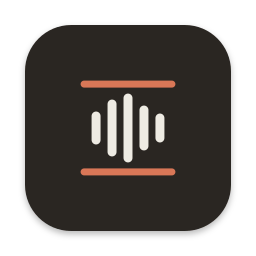
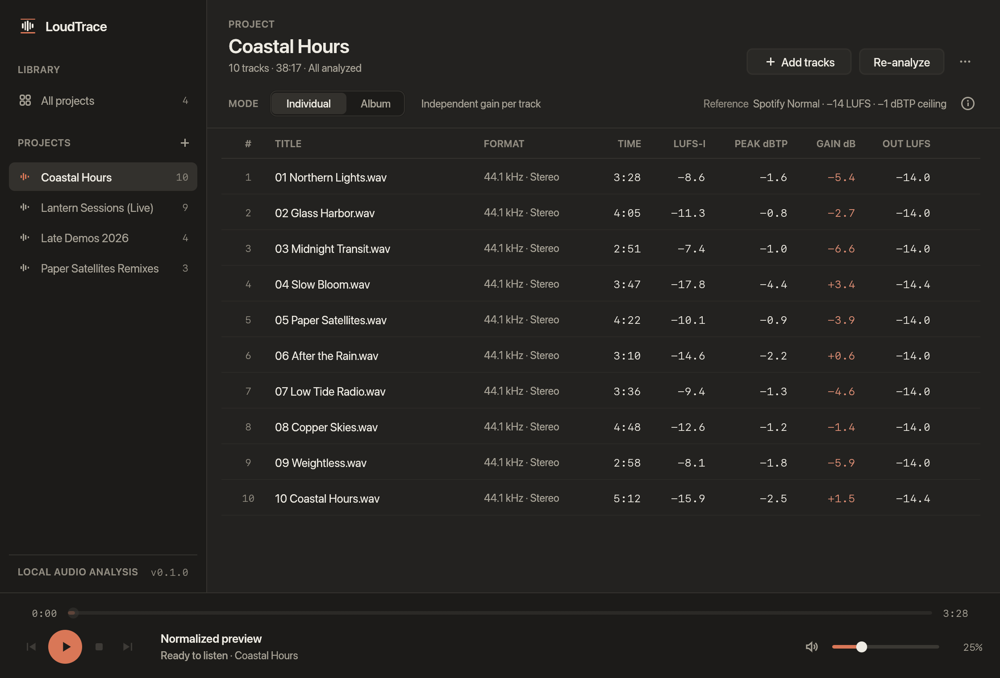

<p align="center">
  
</p>

# LoudTrace

LoudTrace is a desktop app for analyzing track and album loudness and previewing streaming normalization. It measures integrated loudness (LUFS) and true peak, with normalized playback currently based on a Spotify Normal reference model.



To build locally, install Rust 1.95 or newer and your platform's native build tools. Linux also requires ALSA development libraries and `pkg-config`. From the project root, run:

```sh
cargo build --release --locked
```

The executable will be in `target/release/`. To create `target/release/LoudTrace.app` on macOS, run:

```sh
sh scripts/bundle-macos.sh
```
